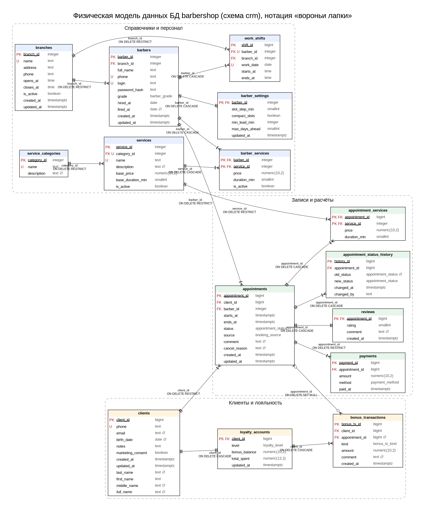

# 2. Модель данных

Концептуальная модель (ER-диаграмма по Чену) —
[docs/it-project/01-er-chen](../it-project/01-er-chen/README.md).
Физическая модель, построенная по каталогу PostgreSQL после применения всех миграций:

Файлы: [er-physical.svg](er-physical.svg), [er-physical.png](er-physical.png),
исходник [er-physical.dot](er-physical.dot), генератор
[_src/physical_er.py](_src/physical_er.py). Обозначения: `PK`/`FK`/`U` — первичный,
внешний ключ, уникальность; `∅` — допускает NULL; курсив — вычисляемый столбец;
на связях — столбец внешнего ключа и действие `ON DELETE`.

## 2.1. От исходной модели к курсовой

| Исходный проект Barber CRM | Проблема | Решение |
|---|---|---|
| 3 отдельные БД (`staff_db`, `booking_db`, `client_db`), 6 таблиц | Нет внешних ключей между `bookings`, `barbers`, `clients`; целостность держится только на коде сервисов | Единая БД `barbershop`, схема `crm`, 15 связанных таблиц с FK |
| `clients.visits_count`, `clients.last_visit` | Производные данные хранятся и рассинхронизируются (нарушение 3НФ) | Вычисляются в представлении `v_client_stats` |
| `bookings.service_id` — одна услуга на запись | Нельзя «стрижка + борода» | Связь M:N `appointment_services` |
| `bookings.service_name`, `price` в записи | Дублирование названия услуги | Название берётся из `services`; цена и длительность — осознанный снимок в `appointment_services` |
| Клиент «принадлежит» барберу (`UNIQUE(barber_id, phone)`) | Один человек — несколько карточек | Клиент сети, `UNIQUE(phone)` |
| `status TEXT` без ограничений | Возможны произвольные значения | `ENUM` + триггер допустимых переходов |
| Проверка пересечений `SELECT … FOR UPDATE` в Go | Не защищает от фантомов (см. раздел 5) | `EXCLUDE USING gist` |
| Нет оплат, лояльности, отзывов, истории, аудита | — | Таблицы `payments`, `loyalty_accounts`, `bonus_transactions`, `reviews`, `appointment_status_history`, `audit.audit_log` |

## 2.2. Состав таблиц

**Содержательные таблицы (15)** — схема `crm`:

| Таблица | Назначение | Ключ | Связи |
|---|---|---|---|
| `branches` | Филиалы, часы работы | `branch_id` | 1:N `barbers`, 1:N `work_shifts` |
| `barbers` | Мастера, грейд, даты приёма/увольнения | `barber_id` | N:1 `branches` |
| `barber_settings` | Настройки онлайн-записи мастера | `barber_id` (= FK) | **1:1** `barbers` |
| `service_categories` | Категории услуг | `category_id` | 1:N `services` |
| `services` | Каталог услуг сети | `service_id` | N:1 `service_categories` |
| `barber_services` | Прайс мастера (цена, длительность) | (`barber_id`, `service_id`) | **M:N** `barbers` × `services` |
| `work_shifts` | Смены мастера по датам и филиалам | `shift_id`, UNIQUE (`barber_id`, `work_date`) | N:1 `barbers`, N:1 `branches` |
| `clients` | Клиенты сети | `client_id`, UNIQUE `phone` | 1:N `appointments` |
| `loyalty_accounts` | Бонусный счёт и уровень | `client_id` (= FK) | **1:1** `clients` |
| `appointments` | Записи (визиты) | `appointment_id` | N:1 `clients`, N:1 `barbers` |
| `appointment_services` | Состав записи, снимок цены | (`appointment_id`, `service_id`) | **M:N** `appointments` × `services` |
| `payments` | Оплаты визита | `payment_id` | N:1 `appointments` |
| `bonus_transactions` | Журнал движения бонусов | `bonus_tx_id` | N:1 `loyalty_accounts`, N:1 `appointments` |
| `reviews` | Отзыв о визите | `appointment_id` (= FK) | **1:1** `appointments` |
| `appointment_status_history` | История смены статусов | `history_id` | N:1 `appointments` |

**Служебные таблицы** (не учитываются в требовании «не менее 8»):
`audit.audit_log` — журнал аудита; `staging.import_batches`, `staging.client_import_rows`,
`staging.import_errors` — пакетная загрузка; `public.schema_migrations` — версии схемы;
материализованное представление `crm.mv_barber_monthly_kpi`.

## 2.3. Функциональные зависимости

Ниже — основные нетривиальные ФЗ (X → Y); во всех отношениях единственные
детерминанты — потенциальные ключи.

| Отношение | Функциональные зависимости |
|---|---|
| `branches` | `branch_id → name, address, phone, opens_at, closes_at, is_active`; `name → branch_id` |
| `barbers` | `barber_id → branch_id, full_name, phone, login, password_hash, grade, hired_at, fired_at`; `login → barber_id`; `phone → barber_id` |
| `barber_settings` | `barber_id → slot_step_min, compact_slots, min_lead_min, max_days_ahead` |
| `services` | `service_id → category_id, name, base_price, base_duration_min, is_active`; `(category_id, name) → service_id` |
| `barber_services` | `(barber_id, service_id) → price, duration_min, is_active` |
| `work_shifts` | `shift_id → barber_id, branch_id, work_date, starts_at, ends_at`; `(barber_id, work_date) → shift_id` |
| `clients` | `client_id → phone, last_name, first_name, middle_name, email, birth_date, notes, marketing_consent`; `phone → client_id`; `lower(email) → client_id`; `(last_name, first_name, middle_name) → full_name` (вычисляемый столбец) |
| `loyalty_accounts` | `client_id → level, bonus_balance, total_spent` |
| `appointments` | `appointment_id → client_id, barber_id, starts_at, ends_at, status, source, comment, cancel_reason` |
| `appointment_services` | `(appointment_id, service_id) → price, duration_min` |
| `payments` | `payment_id → appointment_id, amount, method, paid_at` |
| `bonus_transactions` | `bonus_tx_id → client_id, appointment_id, kind, amount, comment, created_at` |
| `reviews` | `appointment_id → rating, comment, created_at` |
| `appointment_status_history` | `history_id → appointment_id, old_status, new_status, changed_at, changed_by` |

Зависимости, которые **сознательно не** закреплены в схеме:
`barber_id → branch_id` у записи не хранится — филиал визита определяется сменой
(`(barber_id, дата визита) → work_shifts.branch_id`), т. к. мастер может работать в
разных филиалах; хранение `branch_id` в `appointments` было бы транзитивной
зависимостью.

## 2.4. Нормализация

* **1НФ.** Все атрибуты атомарны: ФИО клиента разделено на фамилию/имя/отчество
  (миграция 0005), состав записи вынесен в `appointment_services` вместо списка услуг,
  телефоны и e-mail — отдельные скалярные атрибуты.
* **2НФ.** В отношениях с составным ключом (`barber_services`, `appointment_services`)
  неключевые атрибуты (`price`, `duration_min`, `is_active`) зависят от ключа целиком:
  цена — это цена *данного* мастера на *данную* услугу. Название услуги, которое в
  исходной модели было в `bookings`, зависит только от `service_id` и вынесено.
* **3НФ (и НФБК).** Транзитивных зависимостей нет: категория услуги хранится только в
  `services`, филиал мастера — в `barbers`, статистика клиента не хранится. Во всех
  отношениях каждый детерминант является потенциальным ключом (`login`, `phone`,
  `(barber_id, work_date)` и т. п. объявлены `UNIQUE`), т. е. отношения находятся в НФБК.

### Обоснованная денормализация

| Данные | Почему хранятся | Как поддерживается согласованность |
|---|---|---|
| `appointment_services.price`, `duration_min` | Снимок прайса на момент записи: прайс меняется (в seed — +10 % за 60 дней), а сумма прошлых визитов и выручка меняться не должны | Заполняются только функцией `book_appointment`; прямой записи у приложения нет |
| `appointments.ends_at` | Выводится из `starts_at + Σ duration_min`, но нужен для `EXCLUDE` по `tstzrange(starts_at, ends_at)`, индексации и проверки смены | Вычисляется функциями `book_appointment` и `reschedule_appointment`; прямое изменение запрещено правами (столбцовые привилегии) |
| `loyalty_accounts.bonus_balance` | = `Σ bonus_transactions.amount`; читается при каждом визите и служит точкой блокировки (`FOR UPDATE`) против потерянного обновления | Триггер `trg_bonus_tx_apply` (атомарный `UPDATE … + amount`), `CHECK (bonus_balance >= 0)`; журнал только дописывается |
| `loyalty_accounts.total_spent` | Нужен для уровня лояльности, иначе — агрегация всех оплат клиента | Изменяется только `complete_appointment` в одной транзакции с оплатой |
| `loyalty_accounts.level` | Не является чистой функцией `total_spent`: допускается ручное повышение (акции); автоматически только повышается | Триггер `trg_loyalty_level`: `greatest(level, loyalty_level_for(total_spent))` |
| `clients.full_name` | Удобство поиска и совместимость | `GENERATED ALWAYS AS (…) STORED` — не может разойтись с исходными столбцами |

## 2.5. Типы данных

* Суррогатные ключи — `integer`/`bigint GENERATED ALWAYS AS IDENTITY` (справочники /
  операционные таблицы): компактнее UUID, упорядочены, не могут быть заданы вручную.
* Деньги — `numeric(10,2)` (точная арифметика), накопительные суммы — `numeric(12,2)`.
* Моменты визитов — `timestamptz`; график смен — `date` + `time` в часовом поясе сети
  (функция `crm.shift_start_ts` переводит в `timestamptz`).
* Закрытые множества значений — `ENUM` (`appointment_status`, `payment_method`,
  `barber_grade`, `loyalty_level`, `booking_source`, `bonus_tx_kind`): проверка домена,
  4 байта на значение, упорядоченность (используется `greatest` для уровня).
* Длительности — `smallint` минут с `CHECK` кратности 5; аудит — `jsonb`.

## 2.6. Ограничения целостности

* **PK** — во всех таблицах; **FK** — 17 внешних ключей.
* **UNIQUE** — `branches.name`, `barbers.login`, `barbers.phone`, `clients.phone`,
  `lower(clients.email)` (уникальный индекс по выражению), `services(category_id, name)`,
  `work_shifts(barber_id, work_date)`, `service_categories.name`.
* **NOT NULL** — для всех обязательных атрибутов (см. диаграмму, `∅` — допускает NULL).
* **CHECK** — формат телефона и e-mail, непустые названия, `closes_at > opens_at`,
  `fired_at >= hired_at`, цены > 0, длительности 5..480 и кратны 5, шаг сетки из
  допустимого набора, `ends_at > starts_at` и не более 8 ч, точность до минуты,
  оценка 1..5, `bonus_balance >= 0`, знак суммы бонусной операции по её виду,
  причина обязательна ровно для отменённой записи.
* **EXCLUDE** — `appointments_barber_no_overlap`, `appointments_client_no_overlap`.

### Действия ON DELETE / ON UPDATE

Все ключи — суррогатные `IDENTITY GENERATED ALWAYS`, значение изменить нельзя, поэтому
для всех внешних ключей **ON UPDATE NO ACTION** (каскад изменения ключа не требуется).

| Внешний ключ | ON DELETE | Обоснование |
|---|---|---|
| `barbers.branch_id → branches` | RESTRICT | Нельзя удалить филиал с персоналом; закрытие — `is_active = false` |
| `work_shifts.branch_id → branches` | RESTRICT | История смен определяет филиал визитов |
| `services.category_id → service_categories` | RESTRICT | Сначала перенести услуги |
| `barber_settings.barber_id → barbers` | CASCADE | Зависимая 1:1 сущность без собственного смысла |
| `barber_services.barber_id → barbers` | CASCADE | Прайс существует только вместе с мастером |
| `barber_services.service_id → services` | CASCADE | Удалить можно только неиспользованную услугу (см. следующую строку), её прайсы не нужны |
| `appointment_services.service_id → services` | RESTRICT | Оказанные услуги — история и выручка |
| `work_shifts.barber_id → barbers` | CASCADE | Срабатывает только для мастера без записей: записи защищены RESTRICT |
| `appointments.barber_id → barbers` | RESTRICT | История визитов; увольнение — `fired_at` |
| `appointments.client_id → clients` | RESTRICT | Клиента с историей удалить нельзя |
| `loyalty_accounts.client_id → clients` | CASCADE | Зависимая 1:1 сущность |
| `bonus_transactions.client_id → loyalty_accounts` | CASCADE | Журнал счёта удаляется вместе со счётом (клиент без визитов) |
| `bonus_transactions.appointment_id → appointments` | SET NULL | Операция остаётся в журнале баланса, теряется только ссылка на основание |
| `appointment_services.appointment_id → appointments` | CASCADE | Состав — часть записи |
| `reviews.appointment_id → appointments` | CASCADE | Отзыв — часть записи (1:1) |
| `appointment_status_history.appointment_id → appointments` | CASCADE | История — часть записи |
| `payments.appointment_id → appointments` | RESTRICT | Оплаченный визит удалить нельзя (финансовый учёт) |

## 2.7. Нетривиальные бизнес-ограничения

| № | Правило | Механизм | Почему не в приложении |
|---|---|---|---|
| BR-1, BR-2 | Нет пересекающихся активных записей мастера / клиента | `EXCLUDE USING gist (barber_id WITH =, tstzrange(...) WITH &&) WHERE (status NOT IN (...))` | Проверка в приложении не защищает от фантомов при конкурентной записи; ограничение учитывает незафиксированные строки |
| BR-3 | Запись внутри смены мастера | `BEFORE`-триггер `trg_appointments_validate`, строка смены — `FOR SHARE` | Межтабличное условие; блокировка смены исключает её параллельное удаление |
| BR-4 | Смена внутри часов филиала; нельзя сократить/удалить смену с активными записями | `trg_work_shifts_validate` | Межтабличное условие |
| BR-5 | Автомат статусов, неизменность финальных статусов | `trg_appointments_validate` | Действует для любого клиента БД, а не только для API |
| BR-7 | Σ оплат ≤ стоимость; оплата только идущего/завершённого визита | `trg_payments_validate` с `FOR UPDATE` записи | Агрегатное межтабличное условие под конкурентным доступом |
| BR-8 | Баланс ≥ 0; списание ≤ 30 % чека | `CHECK` + `complete_appointment` | — |
| BR-9 | Отзыв — только о завершённом визите, ≤ 30 дней | `CHECK` + `trg_reviews_validate` | — |

## 2.8. Роли и привилегии

| Роль | Права |
|---|---|
| `crm_owner` | Владелец объектов, выполняет миграции и наполнение |
| `crm_app` | `SELECT` на `crm`; `INSERT/UPDATE/DELETE` на справочники, клиентов, смены, отзывы; `UPDATE (status, comment, cancel_reason)` на `appointments`; **нет** прямой записи в `payments`, `bonus_transactions`, `loyalty_accounts`, `appointment_services`, `appointment_status_history`, `audit.audit_log` — только через `SECURITY DEFINER`-функции и триггеры; `EXECUTE` только на перечисленные функции |
| `crm_readonly` | `SELECT` на представления и справочники (BI) |

Права проверяются автотестами (`TestIntegrityConstraints`: попытки прямой записи в
`payments`, `loyalty_accounts`, изменения `appointments.starts_at`, удаления аудита
возвращают `42501 insufficient_privilege`).
